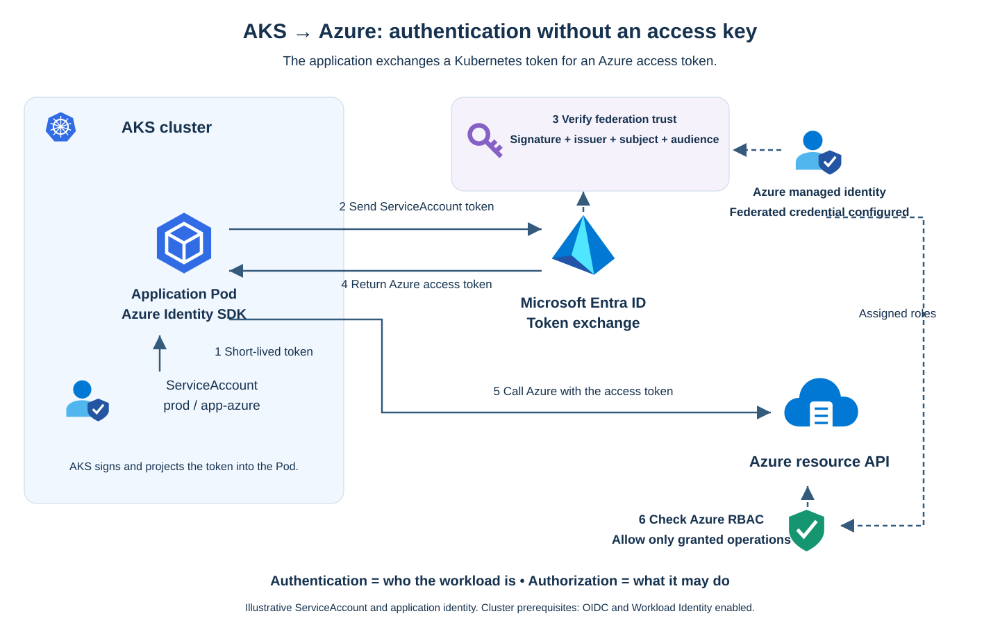

# Azure Kubernetes Service Security Hardening

This project documents the security hardening of an existing **Azure Kubernetes Service (AKS)** cluster. It covers network access restrictions for the Kubernetes API, user authentication through **Microsoft Entra ID**, group-based authorization, resource limits, and application authentication without static credentials.

The project uses an existing test environment in a training center subscription. Changes are introduced incrementally, with documented prerequisites, expected effects, verification steps, and recovery procedures.

## Purpose and Objectives

The scenario starts with a publicly accessible cluster whose administrative access needs to be controlled, and an application that uses a static key to access Azure. The objective is to establish explicit access permissions, reduce unnecessary privileges, and demonstrate the outcome of each change.

The main objectives are to:

- Establish and document the initial cluster configuration before applying security changes.
- Restrict access to the Kubernetes API to the training center's public outbound IP address.
- Enable Microsoft Entra ID authentication and Azure RBAC authorization for Kubernetes.
- Separate human access into administrator and reader groups.
- Test permitted and denied operations, and close historical local-account access paths.
- Apply `ResourceQuota` and `LimitRange` policies in the `prod` namespace.
- Explain how **Microsoft Entra Workload ID** replaces static application credentials.
- Document the change sequence, operational impact, verification results, and recovery options.

## Environment

| Component | Configuration |
|---|---|
| Platform | Microsoft Azure, training center subscription |
| Resource group | `hmezouarRG` |
| Existing cluster | `aks-hmezouar-aks-eval` |
| Region | France Central |
| Observed node pool | One `Standard_D2_v3` node |
| Working environment | Bash in WSL, launched from PowerShell |
| Tools | Azure CLI, kubectl, Git; kubelogin for the Entra ID phase |

The cluster already hosts Argo CD, PostgreSQL, and backup components. Changes must account for these dependencies and preserve existing resources, services, and data.

## Project Status

### Initial Configuration Verified

Checks performed from WSL confirmed the following baseline:

| Check | Observed result |
|---|---|
| Cluster state | `Running`, provisioning successful |
| Kubernetes node | `Ready` |
| Authentication | Local accounts available; Entra ID integration not enabled |
| Kubernetes RBAC | Enabled |
| Kubernetes API | Public, with no authorized IP range restrictions |
| Azure cluster monitoring | Container Insights absent, Managed Prometheus disabled, no AKS diagnostic settings |
| Existing workloads | All listed Pods were `Running` with their containers ready |
| PostgreSQL storage | Persistent volume claim `Bound` |
| `prod` namespace | Absent during the initial baseline; created during implementation and present in the current configuration |
| Resource quotas and LimitRanges | None returned by the inventory |

OIDC and Workload Identity are already enabled at cluster level. The application authentication model is explained in the Workload Identity documentation.

These baseline results describe the environment before hardening. They do not constitute full functional testing of applications or backups.

### Changes Applied and Verified

The following controls have been implemented and verified:

- Restricted API access to the public outbound IPv4 detected on the confirmed Simplon connection: `86.201.70.133/32`.
- Created administrator and reader Entra security groups and assigned their cluster-scoped roles.
- Enabled managed Entra authentication and Azure RBAC for Kubernetes.
- Verified administrator access using Azure CLI authentication through standalone kubelogin in WSL.
- Disabled local accounts and verified that new local admin credential retrieval is refused.
- Created `prod` with a ResourceQuota and LimitRange.
- Verified default resource injection and rejection of requests exceeding the container maximum or namespace quota using server-side dry runs.
- Confirmed that existing Pods remained Running and ready.

The reader group contains Steve THEVAL (`stheval@simplonformations.co`). Read-only behavior still requires verification from his own authenticated session. Separate reader, non-member and outside-IP tests remain outstanding. Previously issued local certificates have not been rotated.

### Next Steps

**Next acceptance test:** [Reader Access Acceptance Test](docs/08-reader-acceptance-test.md).

1. Validate the designated reader account in a separate authenticated session.
2. Test access with a non-member identity and from an unauthorized outbound IP.
3. Review inherited permissions, existing Kubernetes bindings and historical certificate consumers.
4. Complete the screenshot evidence for the acceptance tests.

**Access controls and namespace resource policies have been applied. The remaining access validation is explicitly tracked in [Verification Results](docs/03-verification.md).**

## Documentation and Files

Start with the [Deployment Runbook](docs/09-deployment-runbook.md) to reproduce the configuration on an existing AKS cluster. It covers prerequisites, environment parameters, group creation, role assignments, network restrictions, authentication, resource policies and acceptance tests. Infrastructure provisioning is outside scope.

| Path | Contents |
|---|---|
| [Initial state](docs/01-initial-state.md) | Baseline configuration and observed risks |
| [Access hardening](docs/02-access-hardening.md) | Applied access model |
| [Verification](docs/03-verification.md) | Passed checks and pending work |
| [Resource limits](docs/04-resource-limits.md) | ResourceQuota, LimitRange and admission tests |
| [Workload Identity](docs/05-workload-identity.md) | Authentication flow and implementation checklist |
| [Change plan](docs/06-change-plan.md) | Execution sequence, impact and recovery |
| [Deployment runbook](docs/09-deployment-runbook.md) | Reproduction procedure for an existing cluster |
| [Manifests](manifests/) | Applied resource policies and admission test cases |
| [Screenshots](screenshots/README.md) | Reviewed evidence and outstanding captures |

## Target Access Model

| Identity | Intended access |
|---|---|
| Administrator group | Kubernetes cluster administration |
| Reader group | Read permitted resources, without modification or access to Secrets |
| Users outside these groups | No operational access to Kubernetes resources granted by this project |
| Application | A suitable dedicated or existing Azure identity, with permissions limited to its requirements |

Human access to the API must also satisfy the IP restriction. Existing technical identities and inherited Azure permissions must be reviewed: access to the subscription alone does not determine effective Kubernetes permissions.

## Application Authentication: Workload Identity

Microsoft Entra Workload ID lets an application access Azure using short-lived tokens instead of a permanent access key stored in a Kubernetes Secret.

[Open the editable draw.io diagram](docs/diagrams/workload-identity.drawio)

### How to Read the Diagram

1. **AKS provides a token to the Pod.** The application runs with a Kubernetes ServiceAccount. AKS projects a short-lived, signed token identifying that ServiceAccount into the Pod.
2. **The application requests an Azure token.** The Azure Identity SDK sends the ServiceAccount token to Microsoft Entra ID for the configured Azure identity.
3. **Entra verifies the trust relationship.** It checks the token signature and the federated credential's expected issuer (the AKS cluster), subject (the exact namespace and ServiceAccount) and audience (the token exchange service).
4. **Entra returns an Azure access token.** The SDK handles token acquisition and renewal for the application.
5. **The application calls Azure.** It sends the access token to the target Azure resource API.
6. **Azure checks permissions.** The target service validates the token and evaluates the identity's Azure RBAC permissions for the requested operation and resource scope.

**Authentication establishes who the application is. Authorization determines what it can do.** A valid token does not grant unrestricted access to Azure.

The diagram uses `prod / app-azure` as an illustrative ServiceAccount. OIDC and Workload Identity are enabled on the existing cluster; the application configuration is described in [Workload Identity](docs/05-workload-identity.md).

## Scope

### In Scope

- Security configuration of the existing AKS cluster.
- Authentication, authorization, and access tests.
- Kubernetes resource governance in `prod`.
- Application authentication without static keys.
- Documentation of changes, impacts, and observed results.

### Out of Scope

- Infrastructure provisioning with Terraform, Bicep, or other infrastructure-as-code tools.
- Building a CI/CD pipeline.
- Redesigning or deleting existing applications.
- Implementing a complete highly available production architecture.

Optional extensions include a group and role diagram and a script that guides the operator through the changes step by step.

## Planned Deliverables

- Initial-state assessment and target configuration documentation.
- A change procedure with intermediate checks and recovery measures.
- Kubernetes manifests for resource limits.
- An access test matrix with observed results.
- Screenshots of applied configurations and executed tests.
- An explanation of Workload Identity and its configuration.

Implementation status is supported by recorded verification results. Outstanding tests and dependencies are tracked separately from completed controls.

## Sensitive Information

Kubeconfig files, tokens, private keys, and files containing secrets must not be committed. Evidence must be reviewed before publication to avoid exposing authentication credentials. The `.gitignore` file excludes local `kubeconfig*` files.

## References

- [Microsoft Entra ID authentication for AKS](https://learn.microsoft.com/en-us/azure/aks/entra-id-control-plane-authentication)
- [Azure RBAC authorization for the Kubernetes API](https://learn.microsoft.com/en-us/azure/aks/entra-id-authorization)
- [API server authorized IP ranges](https://learn.microsoft.com/en-us/azure/aks/api-server-authorized-ip-ranges)
- [Kubernetes ResourceQuota](https://kubernetes.io/docs/concepts/policy/resource-quotas/)
- [Kubernetes LimitRange](https://kubernetes.io/docs/concepts/policy/limit-range/)
- [Microsoft Entra Workload ID on AKS](https://learn.microsoft.com/en-us/azure/aks/workload-identity-overview)
