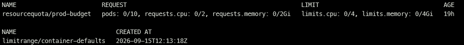

# Screenshot Evidence

Screenshots record the reference deployment. Initial configuration screenshots describe the baseline before hardening.

## Reviewed Images

| Image | Control demonstrated | Review note |
|---|---|---|
| [01 Cluster overview](01-cluster-overview.png) | Cluster identity, resource group, region and operational status | Suitable |
| [02 API restriction](02-api-ip-restriction.png) | Public endpoint with authorized range 86.201.70.133/32 | Configuration evidence; separate outside-network test pending |
| [03 Entra and RBAC](03-entra-rbac.png) | Managed Entra, Azure RBAC and disabled local accounts | Values visible; full command is outside the crop |
| [04 Admin membership](04-admin-membership.png) | Hajar as the sole administrator group member | Suitable |
| [05 Reader membership](05-reader-membership.png) | Steve as the sole reader group member | Suitable |
| [06 Role assignments](06-role-assignments.png) | Four group role assignments at AKS scope | Suitable |
| [07 Admin access](07-admin-access.png) | Ready node and positive administrator permission result | Supporting result; operation not visible |
| [08 Local credential rejection](08-local-admin-denied.png) | Explicit static-credential denial | Supporting result; operation not visible |
| [09 Resource policies](09-prod-policies.png) | prod LimitRange and ResourceQuota | Suitable |
| [09b Policy inventory](09b-prod-policy-inventory.png) | prod-budget ResourceQuota and container-defaults LimitRange are present; quota usage is zero | Supporting inventory; namespace is outside the crop |

### Resource policy inventory

**Figure 9b — Resource policy inventory showing the prod-budget ResourceQuota and container-defaults LimitRange.** The quota reports zero usage against the configured Pod, CPU and memory budgets. This screenshot records object presence and quota values; enforcement is covered by the admission tests. The command and namespace selection are not visible in the crop.

## Outstanding Evidence

- Default resource injection and the two resource-policy rejection tests.
- Post-change workload readiness and monitoring configuration.
- Reader acceptance tests using the reader's actual authenticated session.
- Non-member authorization denial and a controlled test from another outbound IP.

The acceptance criteria are documented in [Resource Limits](../docs/04-resource-limits.md), [Reader Acceptance Test](../docs/08-reader-acceptance-test.md), [Deployment Runbook](../docs/09-deployment-runbook.md) and [Verification Results](../docs/03-verification.md).

Screenshots must identify the operation and result without exposing tokens, login codes, Secret contents or raw kubeconfigs. No image substitutes for a pending functional test.
